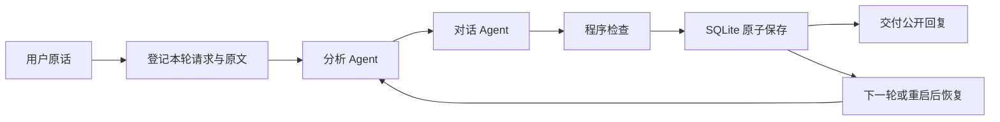

# The Counseling Room

一个围绕现实问题进行自我探索的咨询 Agent 原型。它通过可纠正的多轮对话，帮助用户梳理经历、现实条件、重复模式和可能的解释。

当前本地版本使用 **Python、FastAPI、LangGraph 和 SQLite**，前端使用 Vite 与原生 JavaScript。分析 Agent 整理理解，对话 Agent 决定怎样回应；两个角色都读取用户原话。

> 当前阶段：本地双 Agent 与同会话恢复已实现，真实多轮咨询质量尚未验收。历史线上网站运行的是旧 Node 版本，与当前 Python 代码存在差异。

## 能做什么

- 通过咨询室里的书本进入对话，围绕选择、行动、人际关系和自我理解展开探索。
- 分开保存用户自述、用户解释和模型假设，记录依据、反证、撤回与修订。
- 允许对话 Agent 先承接、直接回答或暂缓探索，不要求每轮提问。
- 在本机保存同一段咨询的原文、内部状态和主动保存快照，支持继续、丢弃与重启恢复。
- 保留历史记录、导出以及基础报告链路。

人格理论只是可选解释工具。项目面向非医疗的自我探索，不提供人格诊断或心理治疗。

## 快速开始

以下命令在项目根目录的 **Windows PowerShell** 中执行。需要 Python 3.12 和 Node.js 20 或更新版本；既有 Python 验证环境为 3.12.14。当前脚本与浏览器测试主要面向 Windows。

```powershell
python -m venv .venv
.\.venv\Scripts\python.exe -m pip install -r requirements-lock.txt
npm ci
npm run build

$env:MODEL_MODE = 'mock'
$env:ANALYSIS_PROVIDER = 'mock'
$env:DIALOGUE_PROVIDER = 'mock'
.\.venv\Scripts\python.exe -X utf8 -m backend --static --port 9019
```

打开 <http://127.0.0.1:9019/>。回复会标明“本地模拟”，无需 API Key，不会调用真实模型或 embedding 服务。停止服务使用 `Ctrl+C`。

`start-local.cmd` 是已有的真实千问启动入口，默认使用端口 9018。首次体验模拟版请使用上面的命令；真实模型配置见[开发与运行](docs/DEVELOPMENT.md)。

## 工作方式



分析 Agent 输出可以被纠正的理解与假设；对话 Agent 结合原文决定采用、暂缓或反对分析建议。程序检查结构、原话引用和状态依赖，成功保存后才向前端交付回复。当前通过 SSE 交付完整结果，不是逐 token 生成展示。

## 当前边界

| 项目 | 状态 |
| --- | --- |
| 双角色编排、共享预算和状态校验 | 已有本地实现 |
| SQLite、请求去重、版本检查与恢复 | 已有本地实现 |
| 千问与 DeepSeek 适配 | 已接入同一双角色图，真实多轮质量待评审 |
| 理论资料检索 | 支持外部快照；作者本地已有94条待审理论向量，不作为仓库内置数据承诺 |
| 沟通案例检索 | 已有接口，当前没有配置案例资料 |
| 工程验证 | 本次Python 160、Node 193、Edge 7项通过，执行位置与限制见[发布验证](docs/VALIDATION.md) |
| 云端部署、跨用户服务和跨咨询画像 | 不属于当前本地版本的完成范围 |

会话默认保存在本机 `%LOCALAPPDATA%\AI-Personality-Explorer\consultations.sqlite3`。真实模型模式会把本轮所需的对话和状态发送给选定供应商；本地保存不代表对话始终不离开本机。

## 文档

- [文档导航](docs/README.md)：按阅读目的找到对应说明。
- [产品与咨询原则](docs/PRODUCT.md)：项目要解决的问题和用户流程。
- [架构与会话协议](docs/ARCHITECTURE.md)：角色、工具回路、状态与 API。
- [开发与运行](docs/DEVELOPMENT.md)：安装、模拟模式、配置和检查命令。
- [评测说明](docs/EVALUATION.md)：工程验证与咨询质量分别如何判断。
- [当前状态与待办](docs/STATUS.md)：已实现、未验收和后续工作。
- [GitHub 发布准备](docs/PUBLISHING.md)：文件范围、外部数据与首次发布事项。
- [发布验证](docs/VALIDATION.md)：本次检查结果及环境限制。
- [变更记录](CHANGELOG.md)。
- [第三方文件说明](THIRD_PARTY_NOTICES.md)。

## 目录

```text
backend/           当前 Python API、双角色编排、检索与会话存储
src/client/        当前前端：入口、房间、咨询、历史和报告
shared/contracts/  前后端协议与公共数据结构
public/assets/     前端图片、音视频和字体
tests/             Python、Node 和浏览器回归
scripts/           Windows 本地配置及启动脚本
server/            历史 Node 后端，保留迁移对照与兼容测试
docs/              当前说明及历史设计记录
```

代码许可尚未选定。字体附带的许可文件需保留；视觉素材、研究资料和向量快照的发布范围分别确认，见[发布准备](docs/PUBLISHING.md)。
